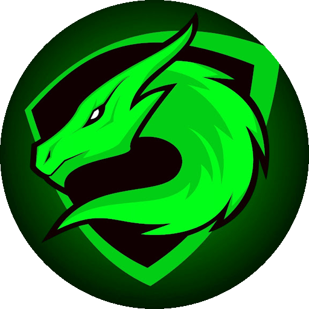

  
  

  

  
  
  
  

<b>EvilDragon's Cheats</b> – ein Cheat-Menü im Spiel für <i>Moon Sweepers</i>.

> **Nur Einzelspieler.** Moon Sweepers hat Online-Koop. Sobald ein anderer Spieler in deiner Crew ist, schalten sich alle Cheats automatisch ab.

## Installation

Die Installation dauert etwa 2 Minuten. Du brauchst **keinen** Mod-Loader (auch kein BepInEx) – alles ist in der ZIP.

### Schritt 1 – Spielordner öffnen

1. Öffne **Steam** und geh in deine **Bibliothek**.
2. Rechtsklick auf **Moon Sweepers** → **Verwalten** → **Lokale Dateien durchsuchen**.
3. Ein Ordner öffnet sich. Darin siehst du die Datei `MoonSweepers.exe`. **Lass diesen Ordner offen.**

### Schritt 2 – Cheats installieren

1. Geh auf die [**Releases**](https://github.com/AdminEvilDRagon/EvilDragons-Cheats/releases)-Seite und lade
   **`EvilDragons-Cheats-MoonSweepers-v1.0.0.zip`** herunter (nimm immer die neueste Version).
2. Öffne die ZIP und kopiere **alles darin** (die Datei `dxgi.dll` und den Ordner `EvilDragon`) in deinen Spielordner.
3. Kontrolle: Neben `MoonSweepers.exe` liegen jetzt `dxgi.dll` und der Ordner `EvilDragon`.

### Schritt 3 – Spielen

Starte das Spiel, lade einen **Einzelspieler**-Spielstand und drück **F1**. Das Menü öffnet sich links.
Das Menü wird etwa 10 Sekunden nach dem Hauptmenü geladen.

## Features

| Tab | Was du machen kannst |
|:--|:--|
| **Player** | Laufspeed bis 5x, Sprunghöhe bis 4x, **Flugmodus mit Noclip** (durch Felsen, Gebäude und Boden) mit einstellbarem Tempo, **Jetpack mit 99 Schüben** |
| **Money** | Geld hinzufügen / abziehen (Vorauswahl oder eigener Betrag), **Auszahlung pro kg** bis 20x |
| **Dust** | **Staubbeutel füllen** / leeren, **endlos Staub**, Beutel bis 20x größer, **Sektionen um dich herum sofort sauber** (3 Größen) |
| **Upgrades** | Jedes Werkzeug, jeden Behälter, den ganzen Skilltree und die Ausrüstung kaufen – **alles auf einmal maximieren** (gratis) oder **gratis Upgrades** |
| **Spawn** | **Staubkapseln** (1, 5 oder 10 volle Kapseln vor dir), **Capsule Catcher**, **Roboter-Docks** mit Roboter |
| **Teleport** | Zurück zum Depot, alle Stationen, Garage, Upgrade-Terminal, Supply Wall, Spind, Karte, Küche, Lounge, Roboter-Docks, Landmarks, **3 Positionen speichern** |
| **Settings** | 6 Themes, Tasten ändern, Benachrichtigungston an / aus, Save Settings |

## Hotkeys

| Taste | Aktion |
|:--:|:--|
| <kbd>F1</kbd> | Menü öffnen / schließen |
| <kbd>F2</kbd> | Ausgewählten Geldbetrag hinzufügen |
| <kbd>F3</kbd> | Flugmodus an / aus |
| <kbd>F4</kbd> | Staubbeutel füllen |

Alle Tasten kannst du im Tab **Settings** ändern. Solange das Menü offen ist, bleibt die Kamera stehen und du hast die Maus frei.

**Flugmodus:** der eigene Flugmodus des Spiels – du fliegst durch alles hindurch.

**Benachrichtigungen:** Jede Aktion meldet sich unten links mit einer kurzen Glas-Karte und einem leisen Klick. Den Ton kannst du im Tab *Settings* ausschalten.

**Save Settings:** im Tab *Settings*. Alle eingeschalteten Cheats sind beim nächsten Spielen wieder an.

## Probleme?

| Problem | Lösung |
|:--|:--|
| F1 tut nichts | Prüfe, ob `dxgi.dll` direkt neben `MoonSweepers.exe` liegt und `EvilDragon\EvilDragon.MoonSweepersCheats.dll` daneben. Warte nach dem Hauptmenü etwa 10 Sekunden. |
| Ich hatte BepInEx installiert | BepInEx 6 läuft mit dieser Unity-Version (6000.6) noch nicht und wird für diese Mod nicht gebraucht. Benenne `winhttp.dll` im Spielordner in `winhttp.dll.off` um. |
| Ich nutze ReShade | ReShade heißt oft auch `dxgi.dll`. Benenne ReShade in `d3d12.dll` um. |
| Virenscanner meldet die DLL | Das ist ein Fehlalarm, weil sich die Mod ins Spiel lädt. Der komplette Quellcode liegt in diesem Repository. |
| Menü sagt, die Cheats sind aus | Andere Spieler sind in deiner Crew – spiel allein. Oder du bist noch im Hauptmenü – lade zuerst einen Spielstand. |
| Etwas anderes | Erstell ein [Issue](https://github.com/AdminEvilDRagon/EvilDragons-Cheats/issues) und häng `EvilDragon\EvilDragon.MoonSweepersCheats.log` an. |

## Deinstallieren

Lösch im Spielordner die Datei `dxgi.dll` und den Ordner `EvilDragon`.

## Hinweise

- Geld, gekaufte Upgrades, gelieferter Staub und gesäuberte Sektionen bleiben in deinem Spielstand.
- Die Mod nutzt die eingebauten Entwickler-Funktionen des Spiels (Geld, Staub, Roboter, Flugmodus) und schaltet sie nur für ihre eigenen Aktionen frei.
- Steam-Erfolge können auch mit aktiven Cheats freigeschaltet werden.
- Deine Einstellungen liegen in `EvilDragon\EvilDragon.MoonSweepersCheats.ini`.

<b>Aus dem Quellcode bauen</b> (für Entwickler)

Moon Sweepers läuft auf Unity 6000.6 (IL2CPP-Metadaten v108). BepInEx 6 und Il2CppInterop unterstützen diese Version noch nicht,
deshalb ist die Mod eine native C++-DLL: Sie sucht Klassen und Methoden über die `il2cpp_*`-Exporte von `GameAssembly.dll`
(die bleiben zwischen Unity-Versionen gleich) und nutzt das ImGui-Overlay und den Loader aus `shared/unreal`.

Voraussetzungen: Visual Studio mit C++-Tools, [Dear ImGui 1.91.5](https://github.com/ocornut/imgui), [MinHook](https://github.com/TsudaKageyu/minhook).

1. `shared\unreal\loader\build.bat` baut die `dxgi.dll` (lädt alle DLLs aus dem Ordner `EvilDragon`).
2. `src\local.bat.example` nach `src\local.bat` kopieren und die Pfade eintragen.
3. `src\build.bat` ausführen.

## Changelog

**1.0.0**
- Erste Version

